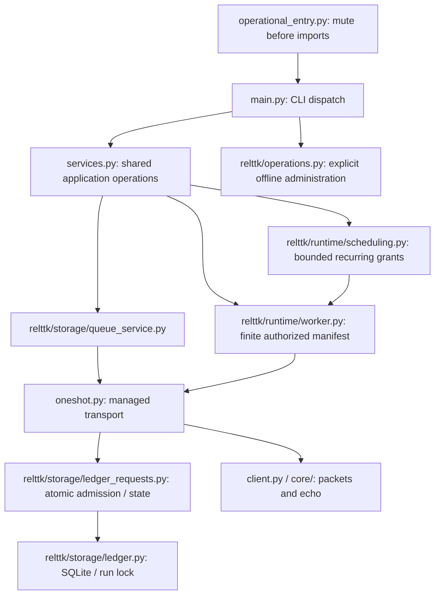

# Existing module architecture

This guide documents the current source layout of TikTok-Client-Bot. The [Phase5B audit](../phases/PHASE5B_ARCHITECTURE_PLAN.md) is historical; the approved Phase5D canonical layout is implemented. G1 moved config, log and runtime_paths into relttk; G2 moved CLI, services and TUI into relttk/application. G3 moved client, oneshot, qrlogin and ws_auth_capture into relttk/transport. G4 moved storage, runtime and identity implementations into their canonical packages. G5 moved operations into relttk/operations.py. G6 verifies the completed layout without source changes; independent final review is pending.

**Debian 13 is the sole future staging target. Identity Contract remains BLOCKED.**
Offline acceptance is not live-production readiness or authorization to send. The project uses unofficial TikTok internal APIs; whether bot messages earn streak credit remains unverified. A correlated server echo is a server acknowledgment, not proof of recipient delivery/read status.

## Module map

| Area | Existing path(s) | Responsibility |
| --- | --- | --- |
| Entry and presentation | main.py, operational_entry.py, relttk/application/cli.py, relttk/application/tui.py, __init__.py | CLI dispatch, muted operational entry, retained terminal interfaces, legacy package export. |
| Shared application boundary | relttk/application/services.py | Wrappers used by CLI/TUI for plans, queue, worker, grants and administration; lazy imports preserve optional dependencies. |
| Managed transport/auth tools | relttk/transport/oneshot.py, relttk/transport/client.py, relttk/transport/qrlogin.py, relttk/transport/ws_auth_capture.py | Managed snapshot/echo transport, explicit WS URL/auth binding; QR/capture tools require separate live authorization. |
| Finite execution and recurring grants | relttk/runtime/worker.py, relttk/runtime/scheduling.py | Durable consent for bounded manifests; recurring grant/window/budget admission. Existing mechanisms are not activated by this guide. |
| Persistence and queue | relttk/storage/ledger.py, relttk/storage/ledger_requests.py, relttk/storage/ledger_migrations.py, relttk/storage/queue_service.py | SQLite lifecycle/readiness, append-only request history, atomic admission, explicit migration and FIFO queue. |
| Identity and account protection | relttk/identity/identity_service.py, relttk/identity/readiness.py, relttk/identity/circuit_breaker.py, relttk/runtime/unknown_resolution.py | BLOCKED identity evidence, runtime preflight, account/session circuit versions and audited UNKNOWN decisions. |
| Templates and rotation | relttk/runtime/rotation.py | Stable template snapshots, selection generation, SUCCESS progression and administrative skip/cancel consistency. |
| Paths/config/output and operations | relttk/runtime_paths.py, relttk/config.py, relttk/log.py, relttk/operations.py | Repository/private runtime roots, shared configuration, explicit offline administration and sanitized output. |
| Protocol/API | core/__init__.py, core/api.py, core/proto.py, core/self_identity.py, core/signer_client.py | Internal TikTok API/protocol helpers; identity provenance refusal and local signer dispatch. |
| Local signers | signers/ | Three tracked Python signing modules; no new signing service is introduced. |
| Legacy plugins | plugins/ | Six tracked Python files; dynamic loader remains legacy/disabled; former external video upload plugin is inert. |
| Manual diagnostics | tools/browsercookies.py, tools/test_ws_capture.py | REVIEW-only optional/manual tools; not default guarded tests or Debian staging commands. |
| Offline verification | tests/ | 37 Python files: runner, fixtures/support and regression modules; historical Phase4 baseline 390 tests; G4/G5 add actual safety/operations-layout cases. |
| Deployment artifacts | deploy/render_units.py, deploy/systemd/ | Offline unit renderer and two existing templates. No install, service activation or VPS action. |

The complete 70-file Python inventory and internal import adjacency table are in the [audit inventory](../phases/PHASE5B_ARCHITECTURE_PLAN.md#2-inventory-and-import-map). Current counts after Phase5E are root 3, core 5, signers 3, plugins 6, deploy 1, tests 37, tools 3 and relttk 51: 109 Python files including aliases/initializers. Folder labels describe responsibility; only the approved G1-G5 package paths are implemented.

## Runtime flow

### CLI and offline operations

main.py parses commands and dispatches through lazy imports. Its default invocation renders an offline plan; it does not open the ledger, inspect cookies or connect to TikTok. Configuration validation currently lives in main and is also imported by oneshot, queue and application services.

relttk/application/services.py exposes shared application operations for the retained CLI/TUI and future integrations. Calls are explicit: importing services does not fetch an inbox or send a plan. Its wrappers delegate queue, rotation, UNKNOWN, finite-worker, recurring-grant, readiness and operations work to their existing modules. relttk/application/cli.py and relttk/application/tui.py are presentation consumers, not independent authorization authorities.

operational_entry.py is the retained deployment entrypoint. It suppresses both Python streams and native stdout/stderr file descriptors **before importing operations/main**. It permits only its restricted operational commands with the operational-output flag. relttk/operations.py emits an allowlisted metadata envelope and handles explicit backup/status administration. Do not replace this entrypoint with a wrapper that imports dependencies first.

deploy/render_units.py validates synthetic/approved unit inputs and renders the existing templates. Rendering text is distinct from installing or activating systemd.

### Persistence, queue and managed transport

relttk/storage/queue_service.py creates/reviews durable requests and controls finite queue consumption. relttk/storage/ledger.py owns SQLite connection/readiness and run-lock primitives. relttk/storage/ledger_requests.py owns request state, transmission markers and transaction admission. relttk/storage/ledger_migrations.py provides explicit, versioned administration. Sending requires an existing valid schema; it does not initialize or upgrade a database.

oneshot.run_oneshot_send is the shared managed transport workflow. Before credentials/network it checks ledger readiness, configuration, verified account/session identity, replay/state and admission previews. It uses the same FIFO and atomic claim logic for legacy --send dispatch and managed consumers. Replay returns existing outcomes; it is not authorization to transmit again.

Conceptual dependency flow (not a literal full call graph):



Some CLI handlers dispatch directly into domain modules rather than always going through one services function. Queue, worker, schedule and ledger admission have additional lazy cross-dependencies not shown here. The diagram does not imply a strict one-way layered architecture.

Managed authentication uses an explicit valid WS access key together with its matching session-bound ttwid. Cookie/session fingerprints and stored auth matching are checked; there is no upstream key fallback. URL validity alone does not establish identity provenance. No UID/routing guess is permitted; the blocked Identity Contract prevents real bootstrap/managed sending.

Transmission uses the request's exact immutable message snapshot for packet construction and correlated echo matching. SUCCESS is committed only on the accepted correlated server echo. A crash/ambiguous outcome after a durable marker remains UNKNOWN; it must not silently retransmit.

### Worker and recurring authorization

relttk/runtime/worker.py processes an existing finite manifest under durable consent and budget, with a single active consumer. relttk/runtime/scheduling.py stores explicitly reviewed recurring grants and occurrences; it does not turn a TUI preference into authority. Same-occurrence replay uses stable idempotency.

Admission includes account/session binding, request state/FIFO, template snapshot validation, quota/cooldown/window, circuits and authorization versions. After waits these gates are checked again atomically. No RunLock, DB or WebSocket is held while waiting. Once a marker exists, shutdown/expiry completes bounded echo handling without retransmission.

Every transmission marker belonging to the manifest counts against its budget, including manual sends and UNKNOWN. OPEN then RESET still changes circuit audit versions, invalidating old consent. UNKNOWN resolution does not create SUCCESS, refund quota, advance rotation or reset a breaker. Any replacement has a new request/key/client identity, keeps its snapshot and does not send automatically.

## Import contracts

The audited static graph has no internal module-level strongly connected component. Including lazy/entry-guard edges creates a **potential 21-module strongly connected component**:
`circuit_breaker`, `client`, `core`, `core.api`, `core.self_identity`, `identity_service`, `ledger`, `ledger_migrations`, `ledger_requests`, `main`, `oneshot`, `operations`, `qrlogin`, `queue_service`, `readiness`, `scheduling`, `services`, `tiktok_tui`, `unknown_resolution`, `worker`, `ws_auth_capture`.

This is syntactic coupling through deferred imports, not a claim of current eager-import failure. Optional/fallback branches are conservatively counted. Dynamic imports and external dependencies are separate from that AST graph.

Important contracts:
- oneshot imports main.validate_config_data eagerly; queue_service/services use validation from main lazily. Moving files would not remove this dependency inversion.
- ledger/ledger_migrations and worker/scheduling cross-import lazily. ledger_requests also invokes queue/worker/scheduling admission: it is more than a storage DAO.
- Root __init__.py exports client; core/__init__.py aggregates protocol/API. New eager exports could introduce import cycles.
- client supports relative and absolute import fallbacks. A transitive ImportError can interact with fallback routing; do not replace imports mechanically.
- client loads adjacent plugins with spec_from_file_location. Static import lists cannot prove those files unused.
- ws_auth_capture and UI imports are optional/lazy in normal command paths. test_ws_capture is an optional manual diagnostic with top-level Playwright import.
- main adjusts sys.path at import; cli may configure stdout encoding; log evaluates output environment; services/ledger capture default paths during import. Preserve side-effect order.
- Tests patch old module globals and functions. import * wrappers do not transparently preserve patched globals, class identity or __file__ inspection.

G1 implements only the approved foundation relocation. Further groups require separate approval of exact consumers, canonical identity, anchors and scanner coverage.

## File and working-directory contracts

| Existing anchor/consumer | Contract to preserve |
| --- | --- |
| relttk/runtime_paths.py | Repository parent of relttk from its file; same private root validation and TIKTOK_RUNTIME_DIR handling |
| relttk/application/services.py | ROOT at import; runtime-local config/preferences, retained legacy session-directory semantics |
| relttk/storage/ledger.py | Import-time state/ledger/run.lock defaults from repository or TIKTOK_RUNTIME_DIR; bound function defaults |
| main.py | Default streak.json is relative to the caller's working directory; run documented commands from repository root |
| relttk/transport/qrlogin.py | Explicit REPO anchor retains upstream sesion spelling; real writes are not part of offline validation |
| relttk/transport/client.py | Explicit REPO anchor retains legacy auth/plugin/state resources; unsupported mutation paths stay refused |
| core/api.py | Parent-parent root/cache anchors; cache is private runtime data, not an audit input |
| relttk/application/tui.py | ROOT/main.py subprocess and cwd=ROOT; Windows-only capture/UI details are retained compatibility |
| deploy/render_units.py | Repository parent and adjacent templates; validates operational entry path |
| tests/run_offline.py | Parent repository root and protected runtime directories |
| tools/test_ws_capture.py | Manual root/work profile; not a fixture test |

Changing __file__ depth, cwd, package import identity or sys.path can select a different private root even when database code is unchanged. Root changes must be verified with disposable synthetic directories and rejection cases; never use real session/state to validate a move.

## Safety gates and guarded coverage

| Contract | Main regression modules under tests/ |
| --- | --- |
| Explicit WS auth, matching session pair, no implicit key or connection on missing auth | test_ws_auth_boundary.py, test_independent_review.py, test_safety_fixes.py |
| Legacy mutation refusal and disabled plugin behavior | test_legacy_send_closure.py, test_streak.py |
| Identity provenance BLOCKED, private roots and readiness | test_identity_bootstrap.py, test_readiness.py, test_runtime_paths.py |
| FIFO/atomic claim, idempotency and durable requests | test_queue.py, test_ledger_v2.py, test_queue_migrations.py |
| Quota/cooldown/window, UNKNOWN markers and clocks | test_rate_limits.py, test_worker.py, test_scheduling.py |
| Rotation/snapshot/cancel/skip history and races | test_rotation.py, test_phase3b_hardening.py |
| UNKNOWN resolution/replacement without SUCCESS or refunds | test_unknown_resolution.py |
| Consent ABA, waits/re-admission, finite and recurring budgets | test_worker.py, test_scheduling.py, test_worker_migrations.py, test_scheduling_migrations.py |
| Muted operational entry, sanitized envelopes, backups and unit text | test_operations.py, test_deployment.py |
| Inbox/protocol and retained application/UI integration | test_api_inbox.py, test_baseline_packets.py, test_tui_services.py |

The WS static regression now scans root *.py and recursively core/, signers/, plugins/, deploy/, tests/, relttk/ and tools/. Private/ignored subdirectories are excluded; other new source roots are **not automatically scanned**. Its checks detect particular AST patterns and do not prove the absence of every possible secret. Any new implementation location requires scanner discovery review and a synthetic coverage regression.

The legacy-send AST tests inspect the real canonical client.__file__ class methods at relttk/transport/client.py. Application source assertions inspect the canonical application files, not alias wrappers. Operations/deployment tests inspect/copy real entrypoints and renderer source. Preserve these checks on canonical implementation; a thin wrapper must not make a scanner pass while hiding unsafe code.

The historical Phase4 full baseline is 390 total, 387 PASS, 3 SKIP, 0 FAIL/ERROR on Windows/Python 3.10 with optional TUI coverage. Historical phase counts remain historical evidence. New executions are recorded separately, not substituted into the [security evidence](../evidence/EVIDENCE_PHASE4_SECURITY.md).

Run the existing guarded suite in the disposable fixture:

```sh
python -B tests/run_offline.py
```

The guard blocks external DNS/connections and protected runtime files; fixtures use fake WebSockets and temporary SQLite databases. It is not a substitute for OS isolation or permission review. A Python venv separates dependencies, not security privileges. Unrestricted discovery can pick up manual diagnostics and is not the approved runner.

## Offline Debian operations

Use the [Debian guide](../operations/DEPLOY_DEBIAN.md) and [Owner fixture checklist](../operations/PHASE4D_OWNER_CHECKLIST.md), together with [README](../../README.md). Deployment artifacts are offline templates and a renderer, not activated services.

Debian 13/Python 3.13 native dependency builds, permissions, locking and WAL capabilities still require Owner-operated fixture verification. Local AST success does not certify those behaviors. The Windows skips for POSIX permissions and missing SQLite no-checkpoint-on-close capability must be re-evaluated on the Debian fixture.

No guide step here grants real session access, migration on runtime data, live HTTP/WS probes, timer activation or sending authority. Identity remains BLOCKED independently of an offline test pass.

## Maintenance procedures

1. Start from the accepted reviewed tree and freeze source/tests/requirements/templates/evidence hashes. Define exact scope, consumers and rollback before implementation.
2. When adding a module, keep existing repository/runtime anchors explicit. Review import-time side effects, optional dependencies and all CLI/test/doc consumers.
3. Before adding a new package path, extend security scanner discovery and prove coverage with synthetic fixtures. Do not put real credentials or permissive dummy auth defaults in source.
4. For import changes, recompute eager/lazy relationships and preserve one canonical module identity. Test old public names, monkeypatch targets, direct commands, exception identity and __file__ consumers.
5. CLI changes require help-only smoke checks under the guard, preview/authorization preservation and negative tests proving failure before transport or database mutation.
6. Add meaningful guarded regressions for changed contracts. Preserve all existing test guards; do not remove assertions or increase skips to obtain a green result.
7. Run AST/import/path/link checks and the full guarded suite. Report exact counts, platform/version and every deviation. Validate Debian capabilities separately before Owner-approved staging.
8. Review runtime schema/migration, identity, auth, worker/grant and transport changes in their own approved scopes. Documentation cleanup never authorizes them.

REVIEW-only: tools/browsercookies.py, tools/test_ws_capture.py and optional requirements/windows.txt workflow. Legacy core/API references to unsupported fyp2 helpers also need explicit supported-workflow review. Disabled plugins have dynamic/test consumers. None is confirmed deletable solely from lack of static incoming imports.

Source history may retain the previously removed upstream WS literal; this guide does not reproduce it or rewrite Git history. Revocation/rotation and any coordinated history remediation remain separate Owner actions.


## Implemented G1 compatibility

Canonical foundation names are relttk.config, relttk.log and relttk.runtime_paths.
Root config.py/log.py/runtime_paths.py are absent. Fixed-target aliases live under
relttk/compat/legacy/ and return the canonical module objects. No eager package
exports, sitecustomize or global import hook is installed.

External callers should use canonical imports. If legacy names are needed, explicitly
call relttk.compat.enable() first. Supported main.py does this during entry setup;
operational_entry.py does so only after output suppression. The guarded runner enables
compatibility after installing its audit guard. Existing conflicting alias objects
are refused, not overwritten. Runtime paths still point to repository/private roots;
no session/state/config data was moved.

G0 toy packages use an isolated g0_layout_fixture namespace after G1, preventing
collision with the real relttk package. See [G1 report](../phases/PHASE5D_G1.md)
for actual-module regression and remaining limits. Historical Phase5 counts/maps
describe their original checkpoints, not the current import layout.

## Implemented G2 application boundary

Canonical names are relttk.application.cli, relttk.application.services and
relttk.application.tui. The application initializer is inert. Root cli.py,
services.py and tiktok_tui.py are absent; explicit compatibility provides bare
cli/services/tiktok_tui names as the same canonical objects. Existing patch targets
remain usable after bootstrap. Imported function bindings retain normal Python
from-import behavior; changing services.CONFIG_PATH after consumers import it does
not retroactively change their copied bindings or default arguments.

main.py imports canonical services/TUI lazily. Application CLI imports main,
canonical transport.oneshot, ledger and canonical services eagerly; TUI imports optional Textual and
canonical services eagerly. Services retains lazy delegation to existing root
modules. Services adds only the REPO path dependency on runtime_paths; no application algorithm or new eager import cycle was added. The cli
alias temporarily removes its own provisional shim during canonical import so
main's repeated bootstrap does not mistake it for a conflicting implementation;
failed imports restore the shim and propagate the exception. Arbitrary cached
legacy module conflicts remain refused.

services.ROOT uses relttk.runtime_paths.REPO, retaining the repository anchor;
TIKTOK_RUNTIME_DIR and config/preferences defaults keep first-import capture.
TUI's subprocess argv/cwd still use root main.py. Supported TUI command remains
`python -B main.py tui`; canonical CLI help is
`python -B -m relttk.application.cli --help` from repository root. Direct execution
of the removed root application files is no longer a supported command.

Guarded tests exercise real legacy/canonical import orders, module initialization,
class serialization, CLI/global/function patches, Textual absent/present,
subprocess argv/cwd and scanner discovery. See [G2 report](../phases/PHASE5D_G2.md)
for results, preservation evidence and compatibility limits. Historical reports
remain unchanged. Identity Contract remains BLOCKED.

## Implemented G3 transport boundary

Canonical names are relttk.transport.client, relttk.transport.oneshot,
relttk.transport.qrlogin and relttk.transport.ws_auth_capture. The transport
initializer is inert. Root implementations are absent; four explicit fixed-target
aliases share the canonical objects, including LttkClient, legacy refusal/console
exceptions and QR stop-event globals. Root __init__.py exports canonical LttkClient.

main/application services, CLI/TUI, queue_service, worker and readiness use
canonical transport imports at their existing eager/lazy points. Transport
modules reference existing root core/API/proto helpers; internal session/capture
imports use canonical names. No packet, snapshot, echo, auth, queue, budget,
consent, retry or UNKNOWN algorithm changed. Client/QR add only the REPO path
imports; the normalized eager graph has no new cycle.

The oneshot alias uses the same provisional-shim removal/restore pattern as CLI
because canonical oneshot imports main, which repeats bootstrap. No global hook
or permissive conflict fallback. Normal copied from-import bindings remain normal
Python bindings; alias identity does not make them dynamic references.

Client's legacy global-auth/plugin/message-state paths and QR's sesion path retain
the repository anchor through relttk.runtime_paths.REPO. TIKTOK_RUNTIME_DIR opt-in,
session binding, private/symlink refusal and fail-before-WS validation remain
unchanged. Path tests use synthetic directories/mocks, never runtime data.

Supported root commands remain `python -B main.py login`,
`python -B main.py capture-ws-auth --help` and other existing main.py commands.
These examples do not grant live login/probe authority. Direct execution of moved
root implementation files is no longer supported; canonical capture help can be
checked with `python -B -m relttk.transport.ws_auth_capture --help` from repo root.
External imports need repository root on sys.path and explicit legacy bootstrap
when using bare names.

Guarded actual G3 regressions cover both import orders, single initialization,
class/exception serialization, auth/packet/session patches, optional dependency
failure, synthetic/private/repository anchors, legacy refusal and scanner reach.
See [G3 report](../phases/PHASE5D_G3.md) for evidence and remaining limits. Moving
modules does not expand the Safety Layer to every retained low-level helper.
Identity Contract remains BLOCKED; G4 is now implemented as described below; G5 is implemented below; G6 verifies the completed layout without source changes; independent final review is pending.

## Implemented G4 safety/storage/runtime identity

Eleven canonical implementations now reside in relttk/storage (ledger,
ledger_requests, ledger_migrations, queue_service), relttk/runtime (worker,
scheduling, rotation, unknown_resolution) and relttk/identity (circuit_breaker,
identity_service, readiness). All three initializers are inert. Eleven fixed-target
legacy aliases share the same implementation objects, globals and exception types.
Root implementations are absent. G1/G2/G3 aliases and official entrypoints remain.

Internal and application/transport/core/operations/renderer consumers use canonical
imports at their previous eager/lazy points. Operations remained at root at the G4 checkpoint; G5 relocation is described below.
Ledger uses REPO for its previous repository anchor; environment/default paths still
capture at first import. No SQLite schema/migration, transaction, FIFO, quota,
snapshot, UNKNOWN, consent, identity, circuit-version or wait/admission algorithm
changed. The normalized eager graph adds only ledger -> runtime_paths for that
anchor, with no return path/new eager cycle. Existing lazy cross-dependencies remain.

Actual G4 regressions prove all eleven import orders/identities, one initialization
per module, exception serialization/inheritance, patches through canonical
consumers, alternate cwd/default capture, disposable WAL commit/rollback, held
legacy RunLock accepted by canonical crash recovery, preserved UNKNOWN/idempotency,
missing-database refusal and scanner discovery. Existing safety regressions remain.
The ledger crash-test subprocess now installs the existing audit guard/bootstrap
before imports, strengthening fixture isolation while retaining all original
crash-boundary assertions. See [G4 report](../phases/PHASE5D_G4.md).

Explicit migration remains administration only. The operational entry still mutes
before imports. Identity Contract remains BLOCKED. Offline fixture results do not
authorize credentials, runtime migration, scheduler activation or sending. G6 is documentation/verification only; final acceptance and Debian fixture staging remain separate Owner decisions.

## Implemented G5 operations identity

The byte-identical operations implementation now resides at relttk/operations.py.
Its fixed legacy alias makes 22 aliases total. Main, shared application services
and operational_entry use canonical imports at their existing lazy positions.
operational_entry still suppresses Python and native output before importing
compatibility, operations or main; only its import target changed.

Eight new guarded regressions prove both import orders, one initialization,
shared patches/metadata state, conflict refusal, silent missing/corrupt/noisy
canonical imports, absent-database refusal, alternate cwd, disposable backup
history preservation and source-scanner coverage. Existing operational negative,
WAL capability, collision and crash tests remain. G0 negative fixtures now inject
faults into the canonical operations path without weakening silence assertions.
See [G5 report](../phases/PHASE5D_G5.md). G6 verifies the completed layout without source changes; independent final review is pending.

## Final G6 verification checkpoint

All 22 planned canonical implementations and 22 fixed aliases are present;
original root implementations are absent. Both import orders return identical
module objects. Explicit compatibility bootstrap remains required for external
bare imports. After Phase5E root contains three Python files: main.py, operational_entry.py
and __init__.py. tools/browsercookies.py and tools/test_ws_capture.py are retained
manual REVIEW-only tools, not dead-code deletion candidates proven by this work.

The current 109-file scanner covers implementations, aliases and tools recursively. Managed
source has no remaining bare imports of the 22 relocated modules. Historical
phase records retain original filenames/counts; conceptual diagram labels are
module names, while the current map above gives physical paths. No package,
source, test, schema, template or dependency changes occur in G6.

Repository/runtime anchors, import-time defaults, optional imports, plugin root
and mute-before-import boundaries remain protected by guarded regression tests.
The [final report](../phases/PHASE5D_FINAL.md) records source preservation, actual
checks, unresolved staging blockers and coordinated rollback instructions.

## Phase5E root hygiene

Optional dependencies live in requirements/tui.txt, auth-windows.txt and windows.txt;
requirements.txt remains the core dependency file at root. tools/__init__.py is
inert. Manual capture keeps the repository/work profile anchor after relocation.
Run it only with separate live authorization as python -B tools/test_ws_capture.py;
this is not a guarded fixture test. Import the optional Windows library as
from tools import browsercookies; old root manual filenames are retired.

TERMUX.md remains a minimal compatibility retirement notice because diagnostics
reference it. work and private runtime files were not read or moved. .gitignore
patterns cover private data; ignoring does not untrack previously committed files.
See [Phase5E](../phases/PHASE5E.md) for exact scope and offline evidence.

## References

- [Phase5A accepted documentation cleanup](../phases/PHASE5A.md)
- [Phase5B audit and alternatives](../phases/PHASE5B_ARCHITECTURE_PLAN.md)
- [Phase5C-Lite execution report](../phases/PHASE5C_LITE.md)
- [Security review](../security/REVIEW.md)
- [Queue and UNKNOWN phase](../phases/PHASE3D.md)
- [Finite worker phase](../phases/PHASE3E.md)
- [Recurring grants phase](../phases/PHASE4B.md)
- [Offline deployment artifacts phase](../phases/PHASE4C.md)

